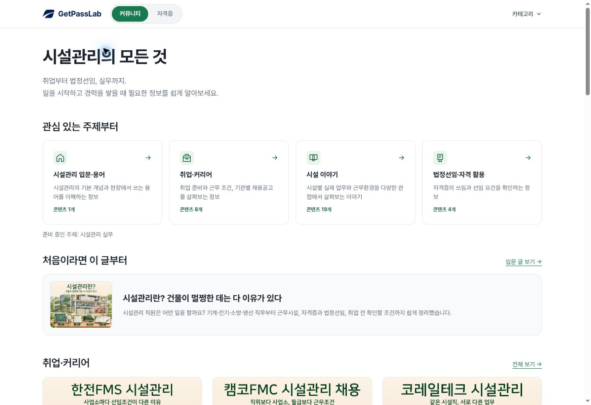
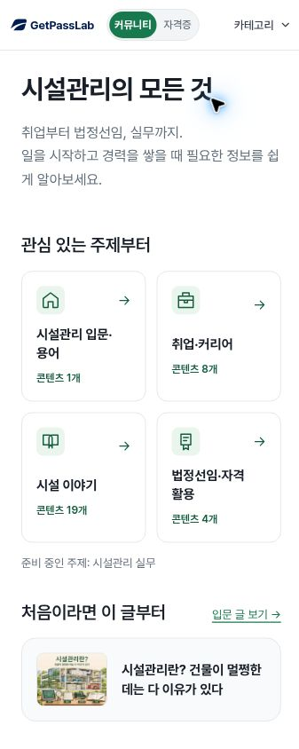

# 시설 메인·목록 UX/UI 개편 검토안

2026-11-19 사용자 구현 요청, 기준 main `292509f9563dd2b6add0e8a520357f3061d2b643`.
[PR #299](https://github.com/syjy813/getpasslab/pull/299), 브랜치 `feat/facility-discovery-ui-20261119`. 검증 대상 `13603363853253ec64a6f5017f26ff7fee34286f`; 후속 변경은 이 기록과 인계 문서만 수정한다. Production 배포는 미실행.

## 문제와 변경

기존 메인은 큰 입문 소개 이미지가 주제 탐색보다 먼저 나타나 모바일 첫 화면에서 카테고리를 찾기 어려웠다. 시설 이야기에서는 사수골대 모음까지 호병백마 10편을 지나야 했다. 화면 관찰에 따른 탐색 비용 판단이며, 전환율 개선을 실측한 결과는 아니다.

- 메인: 주제 선택 → 작은 입문 안내 → 기존 카테고리별 최신 글. 4개 주제는 모바일 2열, PC 4열. 제목·실제 편수·기존 아이콘과 브랜드 사용.
- 목록: 카테고리 이동을 첫 목록 앞으로 옮기고 `aria-current` 유지. 시리즈와 취업 하위 모음에 실제 편수·기본 앵커 링크 제공. 키보드 Enter로 이동하며 고정 GNB 아래에 모음 제목 표시.
- 회차 숫자 정렬, 홈 최신순, 32편 콘텐츠/기존 URL/이미지, 광고·GA4·자격증 학습 화면은 그대로다. 신규 UI 라이브러리·의존성·클라이언트 JS 없음. 조회수 정렬 #278은 제외 상태 유지.

## 검증

- Astro Build 594페이지. SEO 오류 0(기존 경고 12), 공개 콘텐츠 오류 0.
- IA/32편 URL·canonical·시리즈 19편 순서·내부 링크·기존 발행/소스/이미지 보호 검사 PASS.
- `output-diff.json`: 출력 1005개 중 시설 메인 및 카테고리 7개 HTML만 변경. 다른 998개 파일·공유 CSS·자산·본문·자격증 화면 바이트 동일. 추가/삭제 경로 없음.
- `manifest.json`: 변경 3개 제품 소스와 정확한 전후 SHA-256. 기존 발행 보호 검사에서는 이 변경만 정확한 이전 바이트로 복원한다. 역사 audit는 변경하지 않는다.
- 브라우저에서 데스크톱과 340 CSS px(브라우저 확대)의 주제 배치·가로 넘침·카테고리 44px 터치 영역·시리즈 키보드 이동 확인. 실물 모바일 QA와 구분한다. 320/390/768/1440px 공개 시설 자동 회귀 success: run [44427013857](https://github.com/syjy813/getpasslab/actions/runs/44427013857), job 135234355466.
- 원고·이미지 생성·문항·수식 관련 검사는 동일 소스/의존성/설정/출력에 대한 기존 main 검증을 재사용하며 새 UI 검증으로 확대하지 않는다.

브라우저 개발 서버는 Astro 7의 자동 백그라운드 전환과 미리보기 데몬이 충돌해 실행되지 않았다. 제품 코드를 바꾸지 않고 빌드 출력 복사본을 지원되는 정적 미리보기로 열었다. 좁은 화면 스크린샷은 페이지 상단 844px을 기록하며, 화면 아래 지연 로딩 이미지는 별도 스크롤 전에는 빈 자리로 보일 수 있다.

- SEO [44427013799](https://github.com/syjy813/getpasslab/actions/runs/44427013799), 통합 [44427013786](https://github.com/syjy813/getpasslab/actions/runs/44427013786), 자격증 탐색 [44427013830](https://github.com/syjy813/getpasslab/actions/runs/44427013830), 광고 [44427013911](https://github.com/syjy813/getpasslab/actions/runs/44427013911) success.
- 비공개 594페이지 Build PASS. [동일성 대조](preview-equivalence.json): 시설 39개 전체 body·inline CSS·stylesheet URL 및 공유 CSS 바이트가 공개 빌드와 동일하며, 비공개 robots는 39개 모두 noindex/nofollow. 동일 소스·환경·화면에 대한 공개 4폭 레이아웃 검증을 재사용한다. 원격 비공개 CI는 브라우저 도구 설치 중이며 CI success로 확대하지 않는다. 소방/컴활 추가 CI도 진행 중; 관련 소스·의존성·출력은 검증된 main과 동일하다.

## 검토 화면

## 배포 경계

이번 요청은 구현 요청이며 main 병합은 자동 Production 배포를 유발한다. 사용자에게 실제 개편 화면과 PR을 제시하고 이번 개편의 배포 승인을 받은 후 병합한다. 이전 미배포 통합/회차 정렬 배포 승인을 새 개편의 승인으로 확대하지 않는다.
